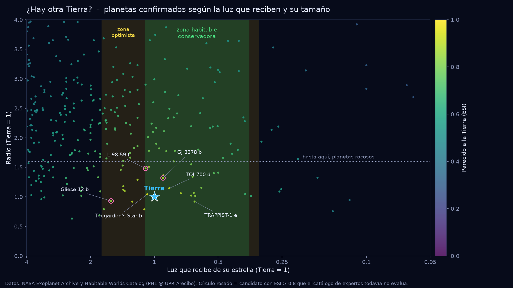
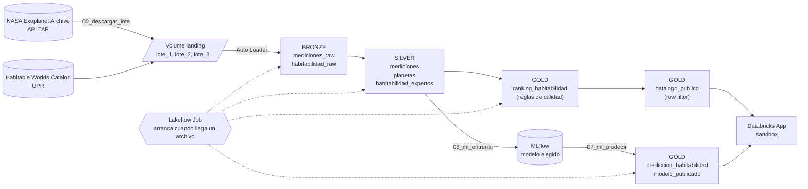

# ¿Hay otra Tierra? 🪐

Proyecto final del Módulo 4 (Gestión y gobernanza de datos con Unity Catalog) del Técnico en Ingeniería de Datos con Databricks, Universidad Latina de Costa Rica.

Quería trabajar con datos reales y con un tema que me diera curiosidad de verdad, así que escogí los exoplanetas: planetas que orbitan otras estrellas. Construí en Databricks un pipeline que toma las mediciones de la NASA, las limpia y calcula qué planetas se parecen más a la Tierra, incluidos los que se descubrieron después de la última actualización del catálogo de habitabilidad que usan los expertos. Encima entrené un modelo de machine learning con el criterio de esos expertos, y todo se puede explorar en una Databricks App que funciona como un sandbox: haces click en un planeta, le cambias valores y ves qué diría el modelo.



## El problema

La NASA tiene confirmados más de 6,400 exoplanetas, pero sus datos no vienen listos para usar. Cada planeta aparece una vez por cada artículo científico que lo midió (algunos hasta 34 veces), a muchas mediciones les faltan datos importantes (en la medición oficial, la luz que recibe el planeta falta en el 85% de los casos) y hay detalles como fechas en tres formatos distintos o referencias que vienen como HTML.

Además, el Habitable Worlds Catalog de la Universidad de Puerto Rico, que es la referencia para saber qué planetas podrían ser habitables, se actualizó por última vez en marzo de 2024. Lo que se descubrió después no tiene evaluación.

La pregunta que responde el proyecto es: **¿qué planetas confirmados se parecen más a la Tierra, incluidos los que el catálogo de expertos todavía no evalúa?**

## Los datos

| Fuente | Qué trae | Cómo llega |
|---|---|---|
| [NASA Exoplanet Archive](https://exoplanetarchive.ipac.caltech.edu/), tabla *Planetary Systems* | Una fila por cada medición publicada de cada planeta confirmado. Uso 36 columnas | Por la API TAP de la NASA, en CSV, por lotes |
| [Habitable Worlds Catalog](https://phl.upr.edu/hwc), PHL @ UPR Arecibo | 5,599 planetas con su índice de parecido a la Tierra (ESI) y si son habitables según los expertos | Un CSV que se carga una sola vez |

Los lotes se separan por la fecha en que la NASA publicó cada medición. El lote 1 es lo publicado antes de 2020 (30,671 mediciones), el lote 2 va de 2020 a septiembre de 2026 (9,583) y desde ahí cada lote nuevo trae solo lo que la NASA publicó después de la última carga. Así el proyecto se comporta como un pipeline real, donde los datos van llegando con el tiempo.

## Cómo funciona



1. **Descarga.** El notebook `00_descargar_lote` le pide a la API de la NASA las mediciones publicadas después de la última carga y las deja como CSV en un volume de Unity Catalog (`landing/mediciones/lote_N/`).
2. **Job.** Cuando aparece un archivo nuevo en el volume, el job `pf_ledezma pipeline` arranca solo y corre cuatro tareas en orden: bronze, silver, gold y las predicciones del modelo.
3. **Bronze.** Auto Loader carga solo los archivos que no ha visto antes y guarda en cada fila de qué archivo vino.
4. **Silver.** Deja los tipos correctos, quita las copias exactas, se queda con un registro por planeta, completa los datos que faltan y lo une con el catálogo de la UPR.
5. **Gold.** Calcula el ESI y si el planeta está en la zona habitable. El ranking tiene reglas de calidad y la versión pública tiene un row filter.
6. **Machine learning.** Un modelo entrenado con el criterio de los expertos evalúa los planetas nuevos que ellos todavía no tienen.
7. **App.** La Databricks App lee lo publicado en gold con su propia identidad.

## Lo que encontré

Los planetas más parecidos a la Tierra según el pipeline:

| Planeta | Distancia | ESI (mío) | ESI (expertos UPR) |
|---|---|---|---|
| Teegarden's Star b | 12 años luz | 0.969 | 0.968 |
| TOI-700 d | 102 años luz | 0.925 | 0.941 |
| TOI-700 e | 102 años luz | 0.911 | 0.912 |
| TRAPPIST-1 d | 41 años luz | 0.908 | 0.908 |
| GJ 3378 b | 25 años luz | 0.897 | no lo tiene |

- De 5,290 planetas con datos suficientes, **77 son potencialmente habitables** según mi regla y **15 de ellos no están en el catálogo de expertos**. Los más interesantes son GJ 3378 b (descubierto en 2026), L 98-59 f (2025) y Gliese 12 b (2024).
- Para revisar que mi cálculo tuviera sentido lo comparé con el de los expertos: en los planetas que ellos sí evaluaron, **coincido en el 99.5%** al decir si un planeta es habitable o no, y la correlación entre los dos ESI es de 0.99.
- El modelo de machine learning le gana a mi regla (F1 de 0.92 contra 0.85) y, de los 650 planetas nuevos, marca **12** como habitables.

## El modelo de machine learning (extra)

**Por qué hacerlo.** Mi regla de zona habitable usa los límites de una estrella como el Sol, y casi todos sus errores contra los expertos están en estrellas más frías: la zona habitable se corre según la temperatura de la estrella. Como el catálogo de expertos ya no se actualiza, entrené un modelo con su criterio para evaluar los planetas que ellos no han visto.

**Los datos.** Los planetas que los expertos sí evaluaron: 4,608, de los cuales solo 58 son habitables (1.3%). Dejé fuera los que la NASA tiene en disputa. Las variables son solo físicas (radio, luz que recibe, temperatura de la estrella y, en una de las pruebas, masa y datos de la órbita). No usé el veredicto ni el ESI de los expertos, que sería copiar la respuesta, ni la distancia a la Tierra o el año de descubrimiento, que no dicen nada de si un planeta es habitable.

**Cómo lo medí.** No con accuracy: decir siempre "no habitable" acierta el 98.7% y no encuentra ningún planeta. Uso precisión, recall, F1 y PR-AUC, con validación cruzada estratificada (5 partes, repetida 3 veces), porque con tan pocos positivos una sola división es muy ruidosa.

| Modelo | Precisión | Recall | F1 | PR-AUC |
|---|---|---|---|---|
| Mi regla (zona habitable del Sol + tamaño) | 0.82 | 0.88 | 0.85 | — |
| Regresión logística (3 variables) | 0.72 | 0.42 | 0.52 ± 0.14 | 0.70 |
| **Gradient boosting (3 variables)** | **0.93** | **0.90** | **0.92 ± 0.05** | **0.94** |
| Gradient boosting (8 variables) | 0.95 | 0.91 | 0.92 ± 0.04 | 0.96 ± 0.02 |

**Cuál elegí.** El más simple cuyo PR-AUC está dentro de una desviación estándar del mejor: gradient boosting con 3 variables (radio, luz que recibe y temperatura de la estrella). Rinde igual que el de 8 dentro del ruido y se puede usar en el simulador de la app con solo tres controles. En el 25% de planetas que guardé y el modelo nunca vio sacó precisión, recall y F1 de 0.93.

**Cómo corre.** `06_ml_entrenar` se corre a mano: compara los modelos, registra cada uno como una corrida en MLflow y deja marcado el elegido. `07_ml_predecir` es la cuarta tarea del job: carga el modelo elegido con `runs:/` y llena `gold.prediccion_habitabilidad`. Así, cuando llega un lote nuevo, los planetas nuevos se evalúan solos sin reentrenar.

**Lo que aprendí por el camino (Free Edition):**
- No se puede registrar el modelo en Unity Catalog, así que se carga desde el experimento con `runs:/<run_id>/modelo`.
- MLflow en serverless necesita `set_tracking_uri("databricks")` y `set_registry_uri("databricks")`; sin eso falla buscando `spark.mlflow.modelRegistryUri`.
- El job y el notebook corrían en ambientes serverless distintos (otra versión de Python y de scikit-learn), y un modelo guardado con una versión no abre con otra (`AttributeError ... CyHalfBinomialLoss`). Fijé scikit-learn 1.5.2 en los dos notebooks y en la app.
- La red de las apps no llega al almacenamiento donde MLflow guarda los archivos del modelo. Por eso el job publica una copia del modelo elegido en `gold.modelo_publicado` y la app la lee por SQL, igual que el resto de los datos.

**Limitaciones.** Son solo 58 planetas habitables para aprender. El modelo aprende el criterio de los expertos, que también es un modelo, no la verdad. Y solo sabe lo que vio: hay muy pocos planetas del tamaño de la Tierra alrededor de estrellas como el Sol (son los más difíciles de detectar), así que ahí duda más; la misma Tierra no le sale al 100%.

## La app: un sandbox

- **Explorar:** el mapa de planetas según la luz que reciben y su tamaño. Haces click en cualquier punto (o en una fila de la tabla) y se abre su ficha, con todas sus mediciones publicadas.
- **Experimentar:** desde la ficha, "Experimentar con este planeta" lo carga en el simulador. Cambias el radio, la luz o la temperatura de la estrella y el modelo responde al instante. El mapa muestra dónde el modelo considera habitable un planeta para esa estrella: con una enana roja, la zona se corre hacia planetas que reciben menos luz. Abajo salen los planetas reales más parecidos.
- **Nuevos descubrimientos:** los planetas que el catálogo de expertos no tiene, con lo que dicen mi regla y el modelo.

## Componentes del proyecto

| Parte | Qué hice | Dónde |
|---|---|---|
| Columna vertebral: bronze | Ingesta incremental con Auto Loader desde un volume, con `schemaLocation`, checkpoint y el archivo de origen en cada fila. Dos lotes que entran una sola vez cada uno | `notebooks/01_bronze.py` |
| Columna vertebral: silver | Tipos correctos, copias exactas fuera, deduplicación por planeta, reglas de nulos, join con el catálogo de la UPR y métricas antes y después | `notebooks/02_silver.sql` |
| C1 · Gold y calidad | Ranking de habitabilidad con reglas `NOT NULL` y `CHECK`, y la prueba de una fila que se rechaza | `notebooks/03_gold.sql`, `notebooks/03b_prueba_calidad.sql` |
| C2 · Orquestación | Lakeflow Job con cuatro tareas (bronze → silver → gold → predicciones), reintentos y trigger por llegada de archivo | `resources/pipeline_job.yml` |
| C3 · Gobernanza | Esquemas por capa, perfil de lectura con mínimo privilegio, row filter con tabla de mapeo y tags | `notebooks/04_gobernanza.sql` |
| C4 · CI/CD | Git folder conectado a este repo, rama `dev`, pull requests a `main` y bundle con targets `dev` y `prod` | `databricks.yml` |
| C5 · Observabilidad | Auditoría, linaje y corridas del job desde las tablas del sistema, y liquid clustering con `OPTIMIZE` en la tabla más grande | `notebooks/05_observabilidad.sql` |
| Extra | Modelo de machine learning con MLflow | `notebooks/06_ml_entrenar.py`, `notebooks/07_ml_predecir.py` |
| Extra | Databricks App tipo sandbox | `app/` |
| Extra | Alerta SQL que revisa todos los días a las 8 a.m. si apareció un planeta con ESI ≥ 0.9 que el catálogo de expertos no tiene | `databricks.yml` |

No reemplacé ningún componente con temas opcionales. El modelo, la app y la alerta son extras que hice porque quería que el resultado se pudiera usar, no solo ver en un notebook.

## Decisiones de diseño

**Lotes por fecha de publicación.** Separar los lotes por la fecha en que la NASA publicó cada medición me permite simular cómo llegan los datos en la vida real y, sobre todo, mostrar en vivo un lote nuevo con lo que la NASA publicó esa misma semana.

**Databricks descarga directo de la NASA.** El notebook de descarga escribe primero en una carpeta temporal y después mueve el archivo a su lote, para que el trigger nunca vea un archivo a medias.

**Trigger por llegada de archivo y no programado.** Los datos nuevos llegan cuando la NASA publica, no a una hora fija, así que tiene más sentido que el job arranque cuando hay algo que procesar. Bronze tiene dos reintentos porque es la tarea que depende del volume.

**Un registro por planeta.** La llave del negocio es el nombre del planeta y me quedo con la medición que la NASA marca como oficial, la más reciente. Si todavía no llegó la oficial, uso la más reciente. Esto pasó de verdad con el lote 1: a varios planetas les faltaba su medición oficial, que llegó en el lote 2.

**Nulos sin promedios.** Cada planeta es distinto, así que rellenar con un promedio sería inventar el dato. Primero busco el valor en otra publicación del mismo planeta; si nadie lo midió, lo calculo (la luz que recibe, con la luminosidad de la estrella y la distancia; el radio, con la masa usando la relación de Chen y Kipping de 2017); la distancia que no trae la NASA la tomo del catálogo de la UPR; y lo que sigue faltando se queda nulo. Con esto, los planetas con datos suficientes para el ranking pasaron de 826 a 5,290.

**ESI simplificado y zona habitable conservadora.** Uso la versión del ESI que solo necesita el radio y la luz que recibe el planeta, y los límites de zona habitable de Kopparapu et al. (2013) para una estrella como el Sol. Es una simplificación, por eso comparé el resultado con el de los expertos antes de confiar en él, y por eso después entrené el modelo.

**Calidad y seguridad en tablas separadas.** Quería poner las reglas de calidad y el row filter en la misma tabla, pero Unity Catalog no lo permite: una tabla con reglas `CHECK` no acepta row filter ni column mask. Por eso `ranking_habitabilidad` lleva las reglas y `catalogo_publico`, que es la que se publica, lleva el filtro.

**Quién ve qué.** Los planetas que la NASA tiene "en disputa" solo los ve quien tenga nivel `investigador` en la tabla de mapeo `gobernanza.mapa_acceso`. El perfil de lectura (`account users`) solo puede leer lo publicado en gold. La app cae en ese perfil: según sus propios logs ve 5,258 planetas, sin los 32 en disputa. El modelo tampoco usa ni evalúa planetas en disputa.

**Liquid clustering por planeta.** La tabla más grande es `bronze.mediciones_raw` y la agrupé por el nombre del planeta, igual que `silver.mediciones`, que es la que consulta la ficha de la app. Elegí liquid clustering en vez de particionar porque hay miles de planetas y saldrían miles de particiones pequeñas.

**Silver y gold se reconstruyen completas.** Son unas 40 mil filas, así que reconstruirlas en cada corrida es simple y rápido. Si el volumen creciera mucho, cambiaría a `MERGE` o a tablas de streaming.

**Entrenar y predecir por separado.** Entrenar se hace a mano cuando hace falta; el job solo predice con el modelo elegido. Es más rápido, el job no cambia de modelo sin que yo lo revise, y cada predicción guarda qué corrida del modelo la hizo.

**Dos ambientes con el mismo código.** Todos los notebooks reciben el catálogo como parámetro. El bundle despliega a `dev` (`pf_ledezma_dev`, con el trigger en pausa) para probar, y a `prod` (`pf_ledezma`) con el trigger activo, la app y la alerta. El experimento de MLflow también lo crea el bundle, uno por ambiente.

## Cómo se corre

Necesitas un workspace de Databricks (sirve Free Edition) y el [Databricks CLI](https://docs.databricks.com/aws/en/dev-tools/cli/).

1. Clona este repo como Git folder en Databricks o en tu compu.
2. En Databricks, corre `notebooks/00_config` para crear el catálogo, los esquemas y el volume.
3. Despliega el job, el experimento de MLflow, la app y la alerta (el trigger del job vigila el volume, por eso va después del paso 2):
   ```bash
   databricks bundle deploy -t prod
   ```
4. Corre `notebooks/00_descargar_lote` con el parámetro **Lote = 1**. El archivo llega al volume y el job carga bronze, silver y gold solo. Después repite con **Lote = 2**.
5. Entrena el modelo corriendo `notebooks/06_ml_entrenar`. Desde ahí, cada corrida del job también evalúa los planetas nuevos.
6. Corre `notebooks/04_gobernanza` (permisos, row filter y tags) y `notebooks/05_observabilidad`.
7. Arranca la app:
   ```bash
   databricks bundle run app -t prod
   ```
8. Para traer lo nuevo de la NASA, corre `00_descargar_lote` con **Lote = siguiente**: si hay mediciones nuevas, el job arranca solo.

Para probar cambios sin tocar prod, usa `-t dev`. Ahí el trigger está en pausa y el job se corre a mano con `databricks bundle run pipeline -t dev`.

## Estructura del repositorio

```
├── app/
│   ├── app.py                    la app: explorar, experimentar, nuevos descubrimientos
│   ├── simulador.py              el sandbox
│   ├── graficas.py · calculos.py · datos.py
├── docs/                         imágenes del README
├── notebooks/
│   ├── 00_config.py              catálogo, esquemas y volume
│   ├── 00_descargar_lote.py      descarga un lote de la NASA al volume
│   ├── 01_bronze.py              Auto Loader
│   ├── 02_silver.sql             limpieza, deduplicación, nulos y join
│   ├── 03_gold.sql               ranking, reglas de calidad y tablas gold
│   ├── 03b_prueba_calidad.sql    fila que se rechaza (no va en el job)
│   ├── 04_gobernanza.sql         permisos, row filter y tags
│   ├── 05_observabilidad.sql     tablas del sistema y liquid clustering
│   ├── 06_ml_entrenar.py         compara modelos y registra el elegido en MLflow
│   └── 07_ml_predecir.py         predicciones del modelo (tarea del job)
├── resources/
│   ├── pipeline_job.yml          el job
│   └── ml.yml                    el experimento de MLflow
├── scripts/descargar_datos.py    consulta a la NASA (la usa el notebook de descarga)
└── databricks.yml                bundle con targets dev y prod
```

## Créditos

- Este proyecto usa datos del NASA Exoplanet Archive, que opera Caltech bajo contrato con la NASA dentro del Exoplanet Exploration Program.
- The Habitable Worlds Catalog (HWC), PHL @ UPR Arecibo. Datos descargados en octubre de 2026.
- ESI: Schulze-Makuch et al. (2011). Zona habitable: Kopparapu et al. (2013). Relación masa-radio: Chen y Kipping (2017).

Mauricio Ledezma · [mauledji.com](https://mauledji.com)
